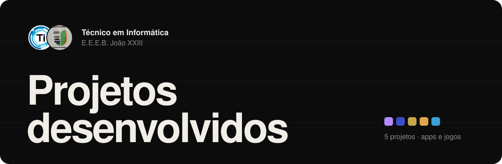
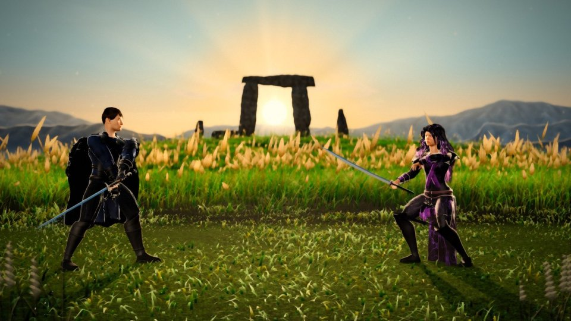
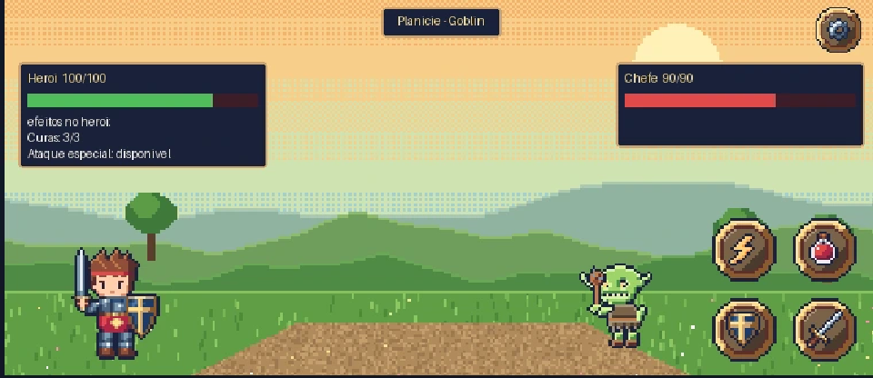
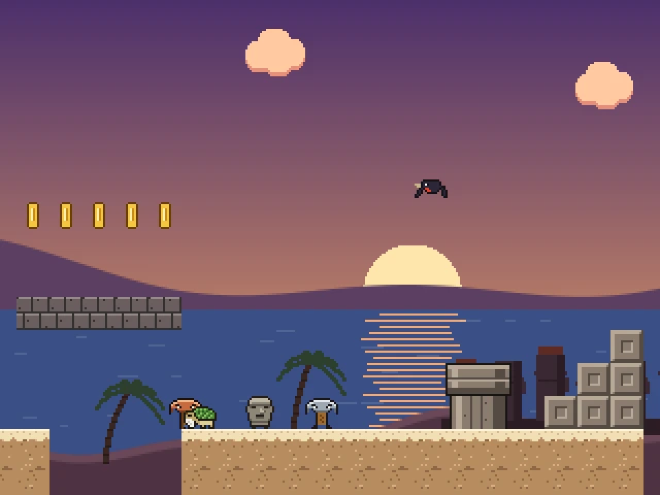

  

  <a href="https://apps.athomon.com"><b>Site dos projetos</b></a>
  &nbsp;·&nbsp;
  <a href="https://www.instagram.com/ti_joaoxxiii/">Instagram do Técnico</a>
  &nbsp;·&nbsp;
  <a href="https://www.instagram.com/eeebjoaoxxiii/">Instagram da Escola</a>

 

## Sobre o curso

O **Técnico em Informática** da **Escola Estadual de Educação Básica João XXIII** (RS) é onde os alunos aprendem programação construindo coisas de verdade: apps Android, jogos 2D e 3D e ferramentas que dá para instalar no celular e usar.

Esta organização reúne esses projetos em um lugar só, com código aberto, prints, créditos de quem fez e o APK para baixar.

 

## Projetos

<table>
  <tr>
    <td width="50%" valign="top">
      
      <h3>Shadow Duel Remastered</h3>
      
Jogo de luta por turnos em 3D: Tharion contra Voyna em 4 fases, com ataque, defesa, cura e golpe especial. Remake do Shadow Duel original, feito em Java no curso.

      
<b>Desenvolvido por</b> Murilo Vieira <b>Jogo original</b> Igor Augusto Gamarra e Murilo Vieira · orientação de Mauri

      
<a href="https://github.com/MuriloDPV/shadow-duel-remake">Código</a> · <a href="https://github.com/MuriloDPV/shadow-duel-remake/releases/tag/apresentacao-v3.2">APK e vídeo</a>

    </td>
    <td width="50%" valign="top">
      

      <h3>ENEMigo</h3>
      
App de estudo para o ENEM no estilo dos apps de idiomas: questões reais de provas anteriores em lições curtas, com XP, vidas, ofensiva, conquistas e caderno de erros. Funciona offline.

      
<b>Desenvolvido por</b> Murilo Spagnoli <b>Em parceria com</b> Murilo Vieira

      
<a href="https://github.com/MuriloDPV/ENEMigo">Código</a> · <a href="https://github.com/MuriloDPV/ENEMigo/releases/latest">APK</a>

    </td>
  </tr>
  <tr>
    <td width="50%" valign="top">
      
      <h3>Boss Rush</h3>
      
Batalhas por turnos contra chefes em quatro áreas (planície, floresta, caverna e reino), em pixel art medieval. Cada chefe derrotado rende cartas; perder volta tudo ao início.

      
<b>Desenvolvido por</b> Gabriel Zatta <b>Em parceria com</b> Murilo Vieira

      
<a href="https://github.com/MuriloDPV/BossRush">Código</a>

    </td>
    <td width="50%" valign="top">
      
      <h3>Aventura do Moai</h3>
      
Plataforma 2D em pixel art: o último moai atravessa Rapa Nui em 3 fases e um mapa secreto, desviando de picaretas, aves arqueiras e tartarugas. Roda no celular e no navegador.

      
<b>Desenvolvido por</b> Igor Augusto Gamarra <b>Em parceria com</b> Murilo Vieira

      
<a href="https://github.com/MuriloDPV/AventuraDoMoai">Código</a> · <a href="https://github.com/MuriloDPV/AventuraDoMoai/releases/latest">APK</a>

    </td>
  </tr>
  <tr>
    <td width="50%" valign="top">
      

      <h3>Wildlife Kingdon</h3>
      
Jogo idle de construção: desenvolva habitats na Floresta, na Ilha Tropical e na Região Polar, colecione animais e veja o mundo evoluir, até com o jogo fechado.

      
<b>Desenvolvido por</b> Leonardo Bohn Heinzmann

      
<i>APK em breve.</i>

    </td>
    <td width="50%" valign="top">
      <h3>O seu projeto aqui</h3>
      
Fez um app, jogo ou ferramenta no curso? <a href="https://github.com/ti-joaoxxiii/ti-joaoxxiii.github.io/issues/new?template=novo-projeto.yml"><b>Enviar projeto</b></a>

    </td>
  </tr>
</table>

 

## Tecnologias usadas nos projetos

  
  
  
  
  
  
  

 

## Como publicar um projeto aqui

Ainda não faz parte da organização? Preencha [**Pedir para entrar**](https://github.com/ti-joaoxxiii/ti-joaoxxiii.github.io/issues/new?template=pedir-para-entrar.yml). Um administrador aprova e manda o convite.

Cada projeto é um repositório desta organização. Para ele aparecer bem no GitHub e no site:

1. **README** com uma frase dizendo o que é, prints, como rodar e os créditos.
2. **Prints** na pasta `docs/` (horizontais para jogos deitados, verticais para apps em pé).
3. **APK** publicado em **Releases**, nunca dentro do código.
4. **Créditos claros:** quem desenvolveu, quem ajudou em parceria e quem orientou.
5. **Nada de senhas ou chaves** no repositório.

Depois é só preencher o formulário [**Enviar projeto**](https://github.com/ti-joaoxxiii/ti-joaoxxiii.github.io/issues/new?template=novo-projeto.yml) para ele entrar no [site](https://apps.athomon.com).

 

## Créditos

**Igor Augusto Gamarra**: Aventura do Moai, Shadow Duel (original) 
**Gabriel Zatta**: Boss Rush 
**Murilo Spagnoli**: ENEMigo 
**Murilo Vieira**: Shadow Duel Remastered, Shadow Duel (original), parceria em ENEMigo, Boss Rush e Aventura do Moai 
**Leonardo Bohn Heinzmann**: Wildlife Kingdon 
**Mauri**: orientação do Shadow Duel original

 

  
  &nbsp;
  
   
  Feito no Técnico em Informática da E.E.E.B. João XXIII

